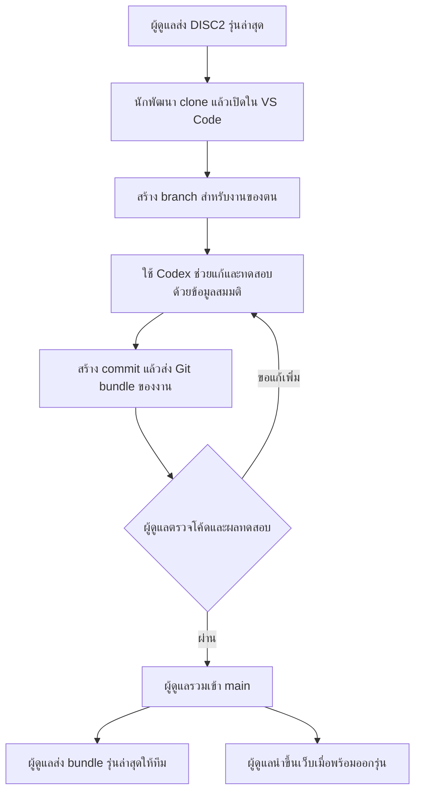

# DISC2 · ระบบสำนวนวินัย

นักพัฒนาเปิด DISC2 ใน VS Code บนเครื่องของตนเอง ใช้ Codex ด้วยบัญชีของตน และรันระบบด้วย PHP 8.5 กับ SQLite จากฐานข้อมูลสมมติของแต่ละสำเนา

คู่มือ PDF สำหรับนักพัฒนาและผู้ดูแลอยู่ที่ [คู่มือพัฒนา DISC2 ร่วมกัน](docs/DISC2-Git-Codex.pdf)

## แผนภาพการทำงาน



**อ่านแผนภาพเป็นข้อความ** · รับโค้ด → สร้างสำเนาบนเครื่อง → แยกงานเป็น branch → แก้และทดลอง → ส่งผู้ดูแล → รวมเข้า `main` → รับรุ่นล่าสุดก่อนเริ่มงานรอบใหม่

| คำที่เจอ | ความหมายใน DISC2 |
|---|---|
| Clone | คัดลอกโค้ดและประวัติลงเครื่องของเรา |
| Branch | พื้นที่ทำงานของงานหนึ่ง เช่น แก้ตัวกรอง |
| Commit | บันทึกชุดการแก้ไขพร้อมชื่อผู้เขียนและคำอธิบาย |
| Git bundle | ไฟล์ส่งโค้ดพร้อมประวัติ Git ทางช่องทางภายในของทีม |
| `main` | สาขาหลักที่ผู้ดูแลรวมงานที่ตรวจแล้ว |
| Pull Request | คำขอให้ตรวจและรวมงานเมื่อทีมใช้ Git กลาง |

## เริ่มงานบนเครื่อง Windows

1. ติดตั้ง Git, VS Code และ PHP 8.5 ให้เทอร์มินัลเรียก `git` และ `php` ได้ เปิด PHP extension `pdo_sqlite` และ `curl` ใน `php.ini` ของเครื่อง
2. เลือกโฟลเดอร์ทำงาน เช่น `C:\Users\<ชื่อผู้ใช้>\dev` วาง `disc2.bundle` ในโฟลเดอร์นั้น แล้วเปิด PowerShell

   ```powershell
   git clone .\disc2.bundle disc2
   Set-Location disc2
   code .
   ```

   เมื่อทีมมี URL ของ Git กลาง ให้ใช้ `git clone <Git-URL> disc2` แทนคำสั่ง clone จากไฟล์
3. ในเทอร์มินัลของ VS Code ตรวจ PHP แล้วสร้างฐานสมมติครั้งแรก

   ```powershell
   php -v
   php --ri pdo_sqlite
   php tools/init.php
   ```

4. เปิด `runtime/demo-accounts.json` เพื่อดูรหัสผ่านที่สร้างให้ `demo-admin`, `demo-owner` และ `demo-reader` เจ้าของสำนวนและหัวหน้ากลุ่มเห็นสำนวน `DEMO-001` หัวหน้ากลุ่มมีสิทธิ์อ่าน
5. เปิดเว็บไซต์ทดสอบ แล้วเข้า `http://127.0.0.1:8760/` จากเบราว์เซอร์บนเครื่อง กด Ctrl+C ในเทอร์มินัลเพื่อหยุดเซิร์ฟเวอร์

   ```powershell
   powershell -NoProfile -File .\tools\serve.ps1 -Port 8760
   ```

   หากพอร์ตถูกใช้อยู่ ให้เลือกพอร์ตว่างและใช้หมายเลขนั้นในเบราว์เซอร์
6. เมื่อต้องลง migrations ใหม่กับฐานทดสอบเดิม ให้รันจากโฟลเดอร์โครงการ

   ```powershell
   $env:DISC2_DEV = '1'
   try { php migrate.php } finally { Remove-Item Env:\DISC2_DEV }
   ```

## ตั้งชื่อผู้เขียน commit ครั้งแรก

เปิดเทอร์มินัลในโฟลเดอร์ `disc2` แล้วระบุชื่อและอีเมลของตัวเอง ค่านี้ใช้กับสำเนา DISC2 ที่เปิดอยู่

```powershell
git config user.name "ชื่อของคุณ"
git config user.email "อีเมลของคุณ"
```

วิธีส่งงานด้วย Git bundle ใช้การส่งไฟล์ผ่านช่องทางภายใน ผู้ดูแลส่งชุดเริ่มต้นให้ผู้พัฒนาที่ได้รับมอบหมาย ส่วน Codex ให้ลงชื่อเข้าใช้ด้วยบัญชี ChatGPT ของตน

## ใช้ Codex ใน VS Code

ติดตั้งส่วนขยาย **Codex** จากหน้า Extensions ลงชื่อเข้าใช้ด้วยบัญชีของตน และเปิดโฟลเดอร์ `disc2` ใน VS Code ไฟล์ `AGENTS.md` มีคำสั่งเริ่มงานและกติกาของระบบ ทดลองสั่งว่า “อ่าน AGENTS.md แล้วอธิบายว่าแท็บ 2 คำนวณวันเริ่มนับอย่างไร พร้อมทดสอบด้วยข้อมูลสมมติ” [คู่มือ Codex ใน VS Code](https://learn.chatgpt.com/docs/codex/ide)

## ส่งงานกลับให้ทีม

อัปเดต `main` จากแหล่งที่ clone มาก่อนสร้าง branch ใหม่ เมื่อรับ `disc2.bundle` รุ่นล่าสุด ให้วางไฟล์ไว้ที่ตำแหน่งที่ใช้ clone ครั้งแรก

```powershell
git switch main
git pull --ff-only origin main
git switch -c feature/case-filter
# แก้โค้ดและทดสอบในสำเนาของตน
git diff
git add <ไฟล์ที่แก้>
git commit -m "ปรับตัวกรองสำนวน"
```

- **เมื่อใช้ไฟล์ Git bundle** ให้รันคำสั่งด้านล่าง แล้วส่งไฟล์ `case-filter.bundle` พร้อมวิธีและผลทดสอบผ่านช่องทางภายในของทีม ผู้ดูแลจะนำเข้า branch และรีวิวก่อนรวมงาน

  ```powershell
  git bundle create ..\case-filter.bundle main..feature/case-filter
  ```

- **เมื่อมี Git กลาง** ให้รัน `git push -u origin feature/case-filter` แล้วเปิด Pull Request เข้า `main` ระบุวิธีและผลทดสอบ

ก่อนส่งงาน ตรวจ `git status` และ `git diff main...HEAD` ให้แน่ใจว่าชุดงานมีเฉพาะไฟล์ที่เกี่ยวข้อง ใช้ข้อมูลสมมติในภาพหน้าจอและคำสั่งที่ส่งให้ AI

## ผู้ดูแลต้องอนุมัติอะไรบ้าง

| เรื่อง | สิ่งที่ผู้ดูแลทำ |
|---|---|
| เริ่มงานด้วย Git bundle | ส่งไฟล์ให้ผู้ได้รับมอบหมาย การตั้งชื่อและอีเมล Git ทำเองได้ |
| สิทธิ์ใช้ Codex | ผู้พัฒนาใช้บัญชี ChatGPT ของตน หากองค์กรจัดการ Workspace ให้ผู้ดูแล Workspace ตรวจสิทธิ์ Codex |
| รวมเข้า `main` | ตรวจโค้ดและผลทดสอบก่อนรวม หากต้องแก้เพิ่ม ให้ส่งกลับไปแก้ใน branch งาน |
| Git กลางแบบ private เมื่อเปิดใช้ | เชิญบัญชี Git รายคน ให้สิทธิ์ส่ง branch และตั้ง `main` ให้รวมผ่าน Pull Request |
| นำขึ้นเว็บ | เลือกรุ่น สำรองโค้ดและฐานข้อมูล แล้วตรวจระบบหลังออกรุ่น |

อ่านคำสั่งและรายละเอียดการรับงาน ตั้งสิทธิ์ และออกรุ่นใน [คู่มือผู้ดูแล Git](MAINTAINERS.md)
