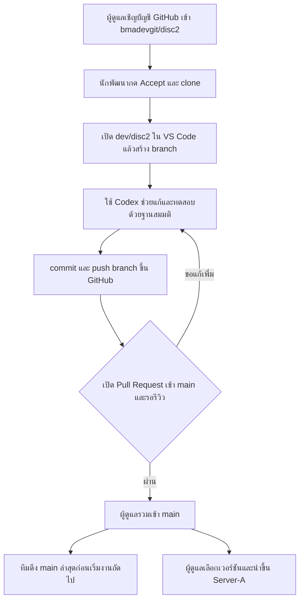

# DISC2 · ระบบสำนวนวินัย

Repository ของทีมคือ [bmadevgit/disc2 บน GitHub](https://github.com/bmadevgit/disc2) แบบ private ผู้พัฒนาใช้บัญชี GitHub ของตนเอง และทำงานบนเครื่องของตนด้วย VS Code, Codex, PHP และข้อมูลสมมติ

- [คู่มือ PDF พร้อมแผนภาพ](docs/DISC2-Git-Codex.pdf)
- [คู่มือผู้ดูแล GitHub และออกรุ่น](MAINTAINERS.md)

## ภาพรวมการทำงาน



อ่านแผนภาพเป็นข้อความ · รับคำเชิญ → clone → เปิดโฟลเดอร์ → สร้าง branch → แก้และทดสอบ → ส่ง Pull Request → ผู้ดูแลรีวิวและรวม

| ตำแหน่ง | ใช้ทำอะไร |
|---|---|
| HTTPS clone URL | `https://github.com/bmadevgit/disc2.git` |
| โฟลเดอร์ที่นักพัฒนาเปิดใน VS Code | `%USERPROFILE%\dev\disc2` เช่น `C:\Users\Nok\dev\disc2` |
| ฐานทดสอบและบัญชีสมมติในโฟลเดอร์นั้น | `runtime/disc2-dev.sqlite` และ `runtime/demo-accounts.json` |
| เว็บทดสอบบนเครื่อง | `http://127.0.0.1:8760/` |
| ตำแหน่งเว็บที่ผู้ดูแลออกรุ่นบน Server-A | `C:\inetpub\wwwroot\exam\disc2` |

## 1. รับสิทธิ์และเตรียมเครื่อง

การติดตั้ง PHP ในหัวข้อนี้ใช้สำหรับเปิดเว็บจาก PowerShell วิธี Docker Compose บน WSL 2 อยู่ในหัวข้อ 3

1. แจ้ง GitHub username ให้ผู้ดูแล กด **Accept invitation** ด้วยบัญชีที่ถูกเชิญ แล้วเปิด [หน้ารายการไฟล์ของ DISC2](https://github.com/bmadevgit/disc2) ให้เห็น README
2. ติดตั้ง [Git for Windows](https://gitforwindows.org/) พร้อม Git Credential Manager, [VS Code](https://code.visualstudio.com/) และ PHP 8.5 สำหรับ Windows ให้ `php.exe` อยู่ใน PATH ใช้ `php --ini` ดูว่า PHP อ่าน `php.ini` ไฟล์ใด แล้วเปิด `extension=pdo_sqlite` และ `extension=curl` ตามคู่มือ PHP [การติดตั้ง PHP บน Windows](https://www.php.net/manual/en/install.windows.php)
3. เปิด PowerShell ใหม่ ตรวจว่า `git --version` และ `php -v` ใช้งานได้ ถ้า Git เปิดหน้าล็อกอินระหว่าง clone หรือ push ให้เลือกบัญชี GitHub ที่กดรับคำเชิญ [การลงชื่อเข้า GitHub ด้วย Git Credential Manager](https://docs.github.com/en/get-started/git-basics/caching-your-github-credentials-in-git)

## 2. Clone และเปิดโฟลเดอร์ที่ถูกต้อง

ที่ GitHub กด **Code → HTTPS** แล้ว copy URL หรือรันคำสั่งข้างล่างใน PowerShell

```powershell
$dev = Join-Path $env:USERPROFILE 'dev'
New-Item -ItemType Directory -Force -Path $dev | Out-Null
Set-Location $dev
git clone https://github.com/bmadevgit/disc2.git disc2
Set-Location .\disc2
git remote get-url origin
code .
```

ผลของ `git remote get-url origin` ควรเป็น `https://github.com/bmadevgit/disc2.git` หากคำสั่ง `code .` ยังใช้ไม่ได้ เปิด VS Code แล้วเลือก **File → Open Folder** ไปที่ `%USERPROFILE%\dev\disc2` โฟลเดอร์ที่ถูกต้องมี `README.md`, `AGENTS.md`, `index.php` และโฟลเดอร์ `tools` [คู่มือ clone ของ GitHub](https://docs.github.com/en/repositories/creating-and-managing-repositories/cloning-a-repository)

## 3. ตั้งชื่อ commit เปิดเว็บ และใช้ Codex

เปิด **Terminal → New Terminal** ใน VS Code จากราก `disc2`

```powershell
Get-Location
git config user.name "ชื่อของคุณ"
git config user.email "อีเมล GitHub ของคุณ"
php --ri pdo_sqlite
php --ri curl
php tools/init.php
powershell -NoProfile -File .\tools\serve.ps1 -Port 8760
```

- ชื่อและอีเมล Git ระบุผู้เขียน commit ใช้อีเมลที่ผูกกับ GitHub หรืออีเมล `noreply` ของบัญชีตน ส่วนการ clone หรือ push ใช้สิทธิ์บัญชี GitHub ที่ผู้ดูแลเชิญ
- รัน `php tools/init.php` ครั้งแรกต่อหนึ่งสำเนา เปิด `runtime/demo-accounts.json` ดูรหัสของ `demo-admin`, `demo-owner` และ `demo-reader` แล้วลองเข้าเว็บที่ `http://127.0.0.1:8760/` ด้วย `demo-owner` จะเห็นสำนวน `DEMO-001`
- ติดตั้ง **Codex** จากหน้า Extensions แล้วลงชื่อด้วยบัญชี ChatGPT ของตน ลองสั่ง “อ่าน AGENTS.md แล้วอธิบายว่าแท็บ 2 คำนวณวันเริ่มนับอย่างไร พร้อมทดสอบด้วยข้อมูลสมมติ” [คู่มือ Codex ใน VS Code](https://learn.chatgpt.com/docs/codex/ide)
- ถ้าพอร์ต 8760 ถูกใช้ เปลี่ยนพอร์ตในคำสั่งแล้วเปิด URL ด้วยหมายเลขเดียวกัน กด Ctrl+C เพื่อหยุดเว็บ เมื่อต้องปรับฐานทดสอบที่มีอยู่ด้วย migrations ใหม่ ให้รันจากรากโครงการดังนี้

```powershell
$env:DISC2_DEV = '1'
try { php migrate.php } finally { Remove-Item Env:\DISC2_DEV }
```

### เปิดเว็บด้วย Docker Compose บน WSL 2

ใช้เทอร์มินัลของดิสโทร WSL 2 ที่เข้าถึง Docker Engine และใช้คำสั่ง `docker compose` ได้ ถ้าใช้ Docker Desktop ให้เปิด WSL Integration สำหรับดิสโทรนั้น วิธีนี้ใช้ PHP ในคอนเทนเนอร์ จึงไม่ต้องติดตั้ง PHP ใน WSL

รันจากรากโครงการ `disc2` ที่มี `compose.yaml` คำสั่ง `export` ตั้งให้คอนเทนเนอร์สร้างไฟล์ทดสอบด้วย UID และ GID ของผู้ใช้ WSL ให้รันในเทอร์มินัลที่ใช้สั่ง Compose

```bash
docker info --format '{{.ServerVersion}}'
docker compose version
export DISC2_UID="$(id -u)" DISC2_GID="$(id -g)"
docker compose build app
```

สร้างฐานและบัญชีสมมติครั้งเดียวต่อสำเนาโครงการ ข้ามขั้นตอนนี้ถ้าสำเนานั้นมีฐานและบัญชีสมมติอยู่แล้ว

```bash
docker compose run --rm app php tools/init.php
```

เริ่มเว็บแล้วดูรหัสผ่านของบัญชีสมมติ

```bash
docker compose up -d app
cat runtime/demo-accounts.json
```

เปิดเบราว์เซอร์ที่ `http://127.0.0.1:8760/` แล้วเข้าด้วย `demo-owner` เพื่อดูสำนวน `DEMO-001` พอร์ตเปิดบน `127.0.0.1` เท่านั้น ใช้เฉพาะข้อมูลสมมติ ฐานและรหัสผ่านอยู่ใน `runtime/` บนเครื่อง `.gitignore` และ `.dockerignore` กันโฟลเดอร์นี้ออกจาก Git และบริบทการสร้างอิมเมจตามลำดับ

หยุดเว็บจากรากโครงการด้วยคำสั่งด้านล่าง ฐานและบัญชีสมมติยังอยู่สำหรับการเปิดเว็บครั้งถัดไป

```bash
docker compose down
```

## 4. ส่งงานผ่าน Pull Request

เริ่มจาก `main` รุ่นล่าสุด แล้วตั้ง branch ให้สื่อถึงงาน ตัวอย่างนี้ใช้ `feature/case-filter`

```powershell
git switch main
git pull --ff-only origin main
git switch -c feature/case-filter
```

แก้และทดสอบบนเครื่อง ตรวจงานก่อน commit แล้วใช้ `git add` กับไฟล์ที่เปลี่ยนจริง

```powershell
git status --short
git diff
git add -- index.php
git diff --cached
git commit -m "ปรับตัวกรองสำนวน"
git push -u origin feature/case-filter
```

บรรทัด `git add -- index.php` เป็นตัวอย่าง ให้แทนชื่อไฟล์ตามงาน จากนั้นเปิด GitHub กด **Compare & pull request** หรือ **Pull requests → New pull request** เลือก **base** เป็น `main` และ **compare** เป็น `feature/case-filter` ระบุสิ่งที่แก้และวิธีทดสอบ แล้วกด **Create pull request** ผู้ดูแลเป็นคนรวมงาน เมื่อมีขอแก้เพิ่ม ให้ commit แล้ว push จาก branch เดิมเพื่ออัปเดต PR เดิม เมื่อรวมเสร็จ ให้ดึง `main` ล่าสุดก่อนเริ่มงานถัดไป

## เคยเริ่มด้วย Git bundle อยู่แล้ว

เปิดโฟลเดอร์ DISC2 ที่มีงานเดิม ตรวจ `git status` และ `git remote -v` ให้แน่ใจว่าเป็นสำเนาของ DISC2 แล้วเปลี่ยนเฉพาะปลายทาง `origin` การเปลี่ยน URL รักษา branch และไฟล์งานเดิมไว้

```powershell
git remote set-url origin https://github.com/bmadevgit/disc2.git
git fetch origin
git remote get-url origin
```

ถ้าพบว่าโฟลเดอร์ `disc2` มีอยู่แล้ว ให้ใช้โฟลเดอร์เดิมตามขั้นตอนนี้ หรือ clone ลงโฟลเดอร์ชื่อใหม่ ถ้า GitHub แสดง **404** หรือ **Repository not found** ให้ตรวจว่าเข้าด้วยบัญชีที่ได้รับเชิญและกดรับแล้ว

### ไฟล์อ้างอิงของ DISC2

- `AGENTS.md` บริบทให้ Codex · `index.php` หน้ารายการ · `case.php` หน้าสำนวน
- `workflow.php` และ `workflow.js` กติกาคำนวณวัน · `migrations/` ไฟล์ปรับโครงสร้างฐาน
- ใช้ข้อมูลสมมติในเครื่องและภาพทดสอบ เก็บฐานสำนวนจริงและค่าลับไว้ในพื้นที่ของผู้ดูแลนอก Git
